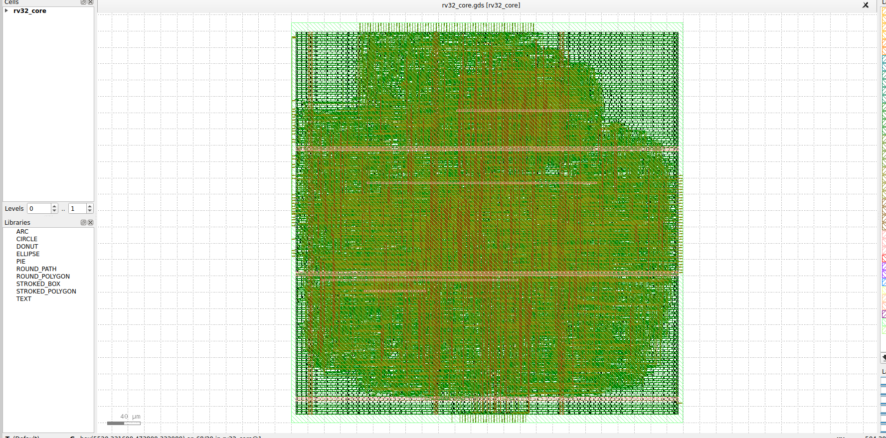

# RTL-to-GDSII Implementation of a 5-Stage RISC-V Core using OpenLane (SkyWater 130nm)

A 5-stage pipelined **RV32I** core written in Verilog, verified with a self-checking
testbench, and taken through the RTL-to-GDSII flow with **OpenLane 2** on the open-source
**SkyWater sky130A** PDK (`sky130_fd_sc_hd`).



## Results

> Fill this table in from `openlane/runs/<tag>/final/metrics.json` after your run.

| Metric | 25 ns clock (40 MHz) |
|---|---|
| Setup worst slack (all corners) | +5.998 ns at max_ss_100C_1v60 (0 violations) |
| Hold worst slack (all corners) | +0.111 ns at min_ff_n40C_1v95 (0 violations) |
| Standard-cell instances | 12,087 (post-layout, incl. tap/fill/buffers) |
| Cell area | 110,396 µm² |
| Core area / utilization | 219,080 µm² / 50.4 % |
| Total power | 9.52 mW |
| Route DRC / Magic DRC / KLayout DRC errors | Magic DRC: 0 (OpenLane DRC check: passed) |
| LVS errors | 0 (circuits match uniquely) |
| Inferred latches | 0 (Yosys check, no latches) |
| Antenna-violating nets | **24 nets / 27 pins (antenna check FAILED)** |

## Microarchitecture

```
   +----+   +----+   +----+   +-----+   +----+
   | IF |-->| ID |-->| EX |-->| MEM |-->| WB |
   +----+   +----+   +----+   +-----+   +----+
    PC,      decode,  ALU,     LD/ST     regfile
    imem     regfile  branch   dmem      write
             read     resolve
```

* ISA: RV32I (integer ops, byte/half/word loads and stores, branches, JAL/JALR, LUI/AUIPC). No CSRs, FENCE, ECALL/EBREAK or traps.
* **Data hazards:** forwarding EX/MEM->EX and MEM/WB->EX, plus register-file write-through (WB->ID).
* **Load-use hazard:** 1-cycle stall, then forwarded from MEM/WB. Load data is not forwarded combinationally out of MEM, which keeps `dmem_rdata` off the EX critical path.
* **Control hazards:** branches and jumps resolve in EX, predict-not-taken, 2-cycle penalty.
* **Memory interface:** separate instruction and data ports (combinational read, byte-strobe write). Memories sit outside the core, so no SRAM macro is needed. Store alignment (byte strobes) and load alignment / sign extension happen inside the core.
* Register file: 31x32 flip-flops (x0 hardwired to zero), 2 read / 1 write ports. Async active-low reset.

### Ports
| Port | Dir | Width | Description |
|---|---|---|---|
| `clk`, `rst_n` | in | 1 | clock, async active-low reset |
| `imem_addr` / `imem_rdata` | out / in | 32 | instruction fetch |
| `dmem_addr` | out | 32 | data address |
| `dmem_wdata`, `dmem_wstrb` | out | 32, 4 | store data, byte strobes |
| `dmem_re` | out | 1 | load request |
| `dmem_rdata` | in | 32 | load data (raw word at `dmem_addr`) |

## Repository layout
```
rtl/        rv32_core.v (top), rv32_alu.v, rv32_regfile.v, rv32_decode.v, rv32_imm_gen.v
tb/         tb_rv32_core.v   self-checking testbench with behavioural memories
sw/         test.S (self-checking program), asm.py (small RV32I assembler), test.hex
openlane/   config.json (OpenLane 2), src/ (copy of rtl/, generated)
scripts/    run_openlane.sh
docs/       layout.png (KLayout screenshot)
Makefile    sim / waves / synth / lint / openlane / clean
```

## Verification
```bash
sudo apt install iverilog yosys
make sim      # assembles sw/test.S, runs the testbench -> "[TB] PASS after N cycles"
make synth    # Yosys generic synthesis + structural checks
make lint     # iverilog -Wall
make waves    # optional: dump a VCD and open it in GTKWave
```
`sw/test.S` covers ALU ops and immediates, forwarding chains (EX/MEM, MEM/WB, write-through),
load-use stalls, byte/half loads and stores, store-data forwarding, all six branch types
(taken, not taken, wrong-path flush), JAL/JALR/AUIPC/LUI, shifts, x0 immutability, a
Fibonacci kernel and a bubble sort. A section counter (`x29`) ensures skipped code cannot pass.

The hazard logic was also mutation-tested on a cycle-accurate model: removing EX/MEM
forwarding, MEM/WB forwarding, write-through, store-data forwarding, the load-use stall,
the IF/ID flush, the ID/EX flush, or swapping forwarding priority was always detected.

## Running the RTL-to-GDSII flow
Needs Docker and OpenLane 2 (`pip install openlane`; Python 3.10+).
```bash
bash scripts/run_openlane.sh [run-tag]      # or: make openlane
```
The script copies `rtl/*.v` into `openlane/src/` (OpenLane's container can only read files
inside the config folder), then runs synthesis, floorplan, PDN, placement, CTS, routing,
antenna repair, multi-corner STA, GDS stream-out, DRC (Magic + KLayout) and LVS (Netgen).
Results land in `openlane/runs/<tag>/final/` (`gds/rv32_core.gds`, `metrics.json`, ...).

Key settings in `openlane/config.json`: `CLOCK_PERIOD` 25 ns, `FP_CORE_UTIL` 40 %,
`PL_TARGET_DENSITY_PCT` 50.

To view the layout: `openlane --last-run --flow OpenInKLayout openlane/config.json`
(or open `final/gds/rv32_core.gds` in KLayout directly).

## Limitations and future work
* No on-chip memories (an OpenRAM SRAM macro could be integrated).
* Memory ports assume combinational read.
* No branch predictor, CSR/trap support or M extension.
* Sweep other clock periods to find the true fmax at all PVT corners.
* Antenna check failed in run1: 24 nets / 27 pins violating. The result is not tapeout-clean.
* OpenLane also reports max-slew violations (45) and max-cap violations (1) in the final metrics.
* Hold slack is positive but thin (+0.111 ns at min_ff_n40C_1v95).
